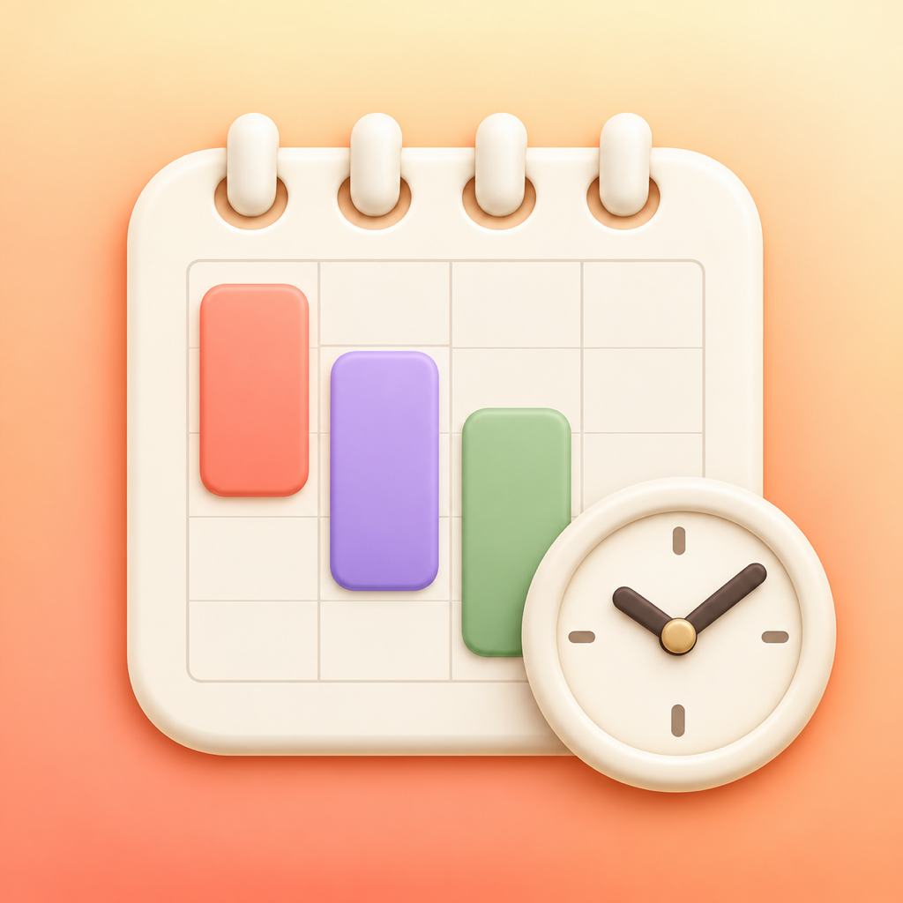

# 柔软时间表 · 1.4.0 离线试用版

[下载 柔软时间表 72小时试用版（Apple Silicon Mac）](Soft-Schedule-Trial-Mac-arm64-v1.4.0.zip)

完整解压后打开名称带“试用版”的应用。需要 macOS 13 或更新版本。

- 从当前 macOS 用户在本机首次启动起连续体验72小时，退出后仍计时。
- 无需联网、账号或登录；应用仅在本机处理数据。
- 到期停止主要功能，已有数据和文件保留。仍可选择已有时间表并逐表导出JSON备份。
- 普通升级或重新解压不重置试用。系统时间明显回拨时暂停使用，纠正后可重试。
- 应用采用本地临时签名，尚未经过 Apple 开发者身份签名和公证。

此仓库当前仅提供试用版。包校验值及分发标记见 [distribution.json](distribution.json)。
